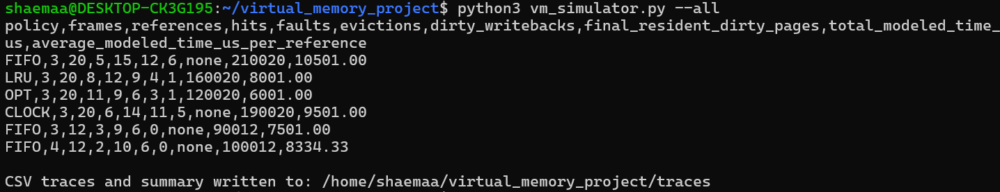
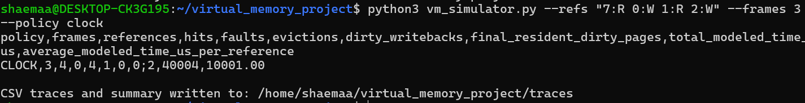
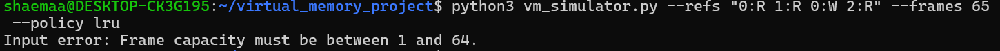
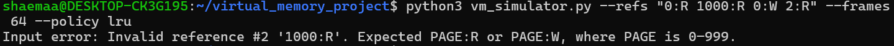

# Virtual Memory Replacement Simulator

A locally runnable Python implementation for the CSE513 Virtual Memory assignment.

## Requirements
- Python 3.10 or newer
- No third-party packages

## Files
- `vm_simulator.py`: simulator implementation (FIFO, LRU, OPT, Clock), dirty bits, writeback accounting, cost model, validation and CSV output.
- `tests/test_simulator.py`: automated verification and the two student-designed tests.
- `traces/`: generated full traces and summary CSV for the six required runs, plus the two additional tests.
- `ubuntu_experiments/`: command template and result-recording template for the required real Ubuntu experiments.

## Run all six required configurations

From this directory:

```bash
python3 vm_simulator.py --all
```

This runs:
- Workload A, 3 frames: FIFO, LRU, OPT and Clock
- Workload B, 3 frames: FIFO
- Workload B, 4 frames: FIFO

CSV files are written to `traces/`.

## Run one configuration

```bash
python3 vm_simulator.py --workload A --frames 3 --policy lru
python3 vm_simulator.py --workload B --frames 4 --policy fifo
```

## Run a custom sequence

```bash
python3 vm_simulator.py --refs "7:R 0:W 1:R 2:W" --frames 3 --policy clock
```

Each token is `PAGE:R` or `PAGE:W`. Page numbers are 0–999. There may be 1–64 frames and 1–256 references.

## Run tests

```bash
python3 -m unittest discover -s tests -v
```

## Model and assumptions
- One process; equal-sized pages; initially empty frames.
- No prefetching, sharing, pinning, background writeback or zero-fill optimization.
- Every absent reference incurs one page input, including write misses.
- A loaded page starts clean; a write sets dirty; reads do not clear dirty.
- Dirty pages are written back only when evicted. Dirty pages still resident at the end are reported, not flushed.
- FIFO insertion age is unchanged by hits.
- LRU recency is updated by both reads and writes.
- OPT uses future references; never-used-again pages are farthest; ties go to the lowest frame index.
- Clock uses reference bits and a circular hand. Dirty bits do not affect victim choice.
- Empty frames are selected by lowest index for FIFO/LRU/OPT. Clock uses its hand and the specified second-chance scan.
- Cost model: `N*1 + F*10000 + D*10000` microseconds.

## Execution Screenshots

The following screenshots demonstrate how to run the simulator and verify its output.

### 1. Run All Required Configurations

Runs all six required workload and page-replacement policy configurations.



### 2. Run a Custom Sequence

Demonstrates running the simulator with a user-defined reference sequence using the Clock policy.



### 3. Invalid Frame Capacity

Demonstrates input validation when the number of frames exceeds the maximum allowed capacity of 64.



### 4. Invalid Page Number

Demonstrates input validation when a page number exceeds the maximum allowed value of 999.

